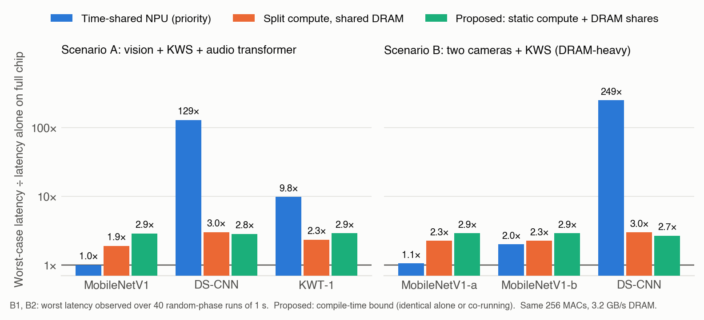
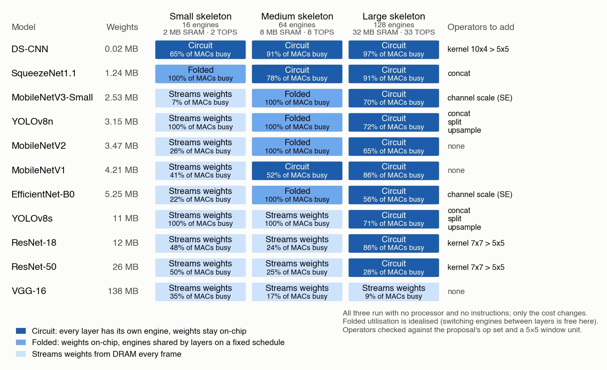

# Instruction-Free Dataflow Fabric

**Deterministic, instruction-free multi-model inference on a configurable spatial dataflow fabric for real-time edge systems**

Author: **Kulamani Rout** · [github.com/kulamani007](https://github.com/kulamani007)

## Core idea

Today a neural network on an edge NPU runs as a **program**: a processor or runtime dispatches
every layer, and models that share the accelerator compete for it at run time, so a model's
latency depends on what else is running.

This work proposes running CNNs as **circuits** instead: a fixed hardware **skeleton**, built
once in silicon, that any CNN within its range can be configured to become. A compiler turns
each model into configuration, routing, memory placement and a static schedule; no
general-purpose instruction processor takes part in the inference loop. Because nothing is
decided at run time, every model's worst-case latency is known before inference, even when
several models share the chip, and the skeleton stays reprogrammable for new models.

## Results at a glance

Early, simulation-based results (November 2026):

| Question | Result |
|---|---|
| Does co-running change a model's latency? | On a time-shared NPU model with equal resources, a keyword-spotting network's worst-case latency grows **129×** next to MobileNetV1 and **249×** next to two camera models. With static partitioning each model has **one fixed latency**, equal to its compile-time bound. |
| What does isolation cost? | About **2.9×** latency for the largest model in the mix (still within its deadline); the compiler's objective decides which model pays. |
| Which CNNs can a skeleton become? | Across 11 reference CNNs and three skeleton sizes, on-chip weight capacity, layer count and operator coverage define the range; past it, a model folds or streams weights instead of failing. |
| Can a first prototype fit an FPGA? | A three-model skeleton (20 engines) is estimated at 16 % of the DSPs and 32 % of the block RAM of a Zynq UltraScale+ ZU19EG. |
| Window extraction | Compiler-selected shift-reuse reduces window-fetch SRAM reads by **57 %** on MobileNetV1's 3×3 layers. |

These are simulation results with stated limits; hardware validation is in progress.

## Contents

| Path | What it is |
|---|---|
| [`proposal/`](proposal/) | Research proposal (PDF + Markdown) |
| [`notes/2026-11-01_core-message-and-claims.md`](notes/2026-11-01_core-message-and-claims.md) | The core message, closest prior work, and the testable claims |
| [`figures/`](figures/) | Result figures |

The early simulation code (version 0.1) is archived on Zenodo with the DOI above. Ongoing
development, models and hardware design are maintained privately; please contact the author
for collaboration.

## Idea log

| Date | Entry |
|---|---|
| Aug–Sep 2026 | Concept development: processor-free, layer-mapped spatial fabric for edge AI |
| 22 Sep 2026 | Proposal v1: configurable stage fabric; compiler-generated configuration, routing, memory, and schedule; no instruction processor in the inference loop |
| 22 Sep 2026 | Window-extraction unit: cyclic 2-D RAM banking for single-cycle M×N window fetch; multi-hot bank-enable mask for clock gating |
| 23 Sep 2026 | Stride-driven window address generator; FULL vs SHIFT fetch modes; MobileNetV1 read analysis (57% fewer window-fetch SRAM reads) |
| 24 Sep 2026 | Heterogeneous convolution engines per stage with multi-model co-scheduling and provable non-interference |
| 29 Sep 2026 | Validation method: FPGA as cycle-accurate emulation, ASIC flow for area/timing/energy, MPW test chip as stretch goal |
| 30 Sep 2026 | External memory tier with double buffering; polyphase (space-to-depth) instead of im2col for strided layers |
| 1 Nov 2026 | [Core message: a CNN skeleton that becomes any model in its range, as a circuit; testable claims C1–C4](notes/2026-11-01_core-message-and-claims.md) |
| 1 Nov 2026 | Composability experiment and skeleton fit map of 11 CNNs |
| 1 Nov 2026 | Lookup tables instead of multipliers assessed; tiny three-model skeleton as first FPGA prototype target; precision plan (INT8 default, optional 4-bit) |
| 2 Nov 2026 | Version 0.1 archived on Zenodo |
| 4 Nov 2026 | Bit-exact INT8 golden model for hardware verification |

## Citing this work

If you use or build on these ideas, please cite this work and contact the author:

> Kulamani Rout, *Instruction-Free Dataflow Fabric: Deterministic Multi-Model Inference on a Configurable Spatial Dataflow Fabric for Real-Time Edge Systems*, Zenodo, 2026. [doi:10.5281/zenodo.23884182](https://doi.org/10.5281/zenodo.23884182)

This DOI always resolves to the latest version (v0.1: [10.5281/zenodo.23884183](https://doi.org/10.5281/zenodo.23884183)). See also `CITATION.cff`.

## License

Documents: [CC BY 4.0](https://creativecommons.org/licenses/by/4.0/). Reuse requires attribution.
Code in the v0.1 archive: MIT. See `LICENSE`.
